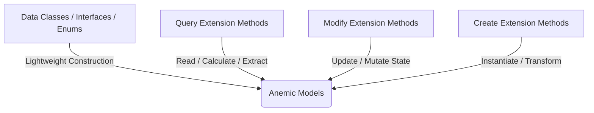

# DiGi.Weather

**DiGi.Weather** is the weather data library of the DiGi software ecosystem. It provides lightweight, serializable domain models for hourly meteorological data — an indexed [Weather](DiGi.Weather/Classes/Weather.cs) container and per-hour [WeatherRecord](DiGi.Weather/Classes/WeatherRecord.cs) measurements — designed to be consumed by the simulation, solar, and analytical libraries across the Revit, Rhino, Grasshopper, and Dynamo integrations.

The library targets **.NET Standard 2.0** and builds directly on [DiGi.Core](https://github.com/DiGi-Organization/DiGi.Core)'s `SerializableObject` pattern, so every model supports reflection-driven JSON persistence, cloning, and polymorphic deserialization out of the box.

---

## 🏗️ Library Overview

The assembly is organized into the two data layers of the DiGi.Core pattern — anemic model classes and their marker interfaces.

### Classes ([DiGi.Weather.Classes](DiGi.Weather/Classes))
* **[WeatherRecord.cs](DiGi.Weather/Classes/WeatherRecord.cs):** A single hourly record holding the standard meteorological measurements (dry bulb / dew point temperature, relative humidity, atmospheric station pressure, direct / diffuse / global radiation and illuminance, wind direction and speed, sky cover, ceiling height, snow depth, and more). Each measurement is exposed as a read-only property carrying its physical unit in the documentation, keyed by its `DateTime`.
* **[Weather.cs](DiGi.Weather/Classes/Weather.cs):** A container of weather records.
  * `Weather<TWeatherRecord>` — the generic base container. It indexes records by `DateTime` in a dictionary (deduplicating on timestamp) and implements `IEnumerable<TWeatherRecord>` for direct iteration over the stored records.
  * `Weather` — the concrete `Weather<WeatherRecord>` specialization used by consumers.

### Interfaces ([DiGi.Weather.Interfaces](DiGi.Weather/Interfaces))
* **[IWeatherObject.cs](DiGi.Weather/Interfaces/IWeatherObject.cs):** The base marker interface for all weather objects (`: DiGi.Core.Interfaces.IObject`).
* **[IWeatherSerializableObject.cs](DiGi.Weather/Interfaces/IWeatherSerializableObject.cs):** The serializable marker interface (`: IWeatherObject, DiGi.Core.Interfaces.ISerializableObject`). Every serializable model in the project implements this.
* **[IWeatherRecord.cs](DiGi.Weather/Interfaces/IWeatherRecord.cs):** Contract for a weather record, exposing the `DateTime` used as the container key.

---

## 🎨 The DiGi.Core Architectural Pattern

DiGi.Weather follows the ecosystem-wide separation of concerns: **data models** (anemic schemas) are kept distinct from **business logic** (static extension methods). All new features must follow this pattern.



### 1. Data Models (Classes, Interfaces, Enums)
* **Directory Structure:** Located under `/Classes` (Namespace: `DiGi.Weather.Classes`), `/Interfaces` (Namespace: `DiGi.Weather.Interfaces`), or `/Enums` (Namespace: `DiGi.Weather.Enums`).
* **Scope:** Lightweight properties and basic constructors only. **No complex business logic** is allowed inside the model classes themselves.

### 2. Business Logic (Extension Methods)
All operations, calculations, and conversions are implemented as static **Extension Methods** grouped into static partial classes — never a new manager/service class:
* **Query** (`/Query` → `public static partial class Query`): Returns values or calculations based on the object state without mutating it (e.g., averaging a temperature series, extracting a design day).
* **Modify** (`/Modify` → `public static partial class Modify`): Modifies the state or properties of the target object.
* **Create** (`/Create` → `public static partial class Create`): Instantiates and returns a brand-new object (e.g., building a `Weather` container from a parsed weather file).
* **Convert** (`/Convert/To[TargetArea]` → `public static partial class Convert`): Converts, formats, or transforms an object or raw components into another representation (e.g., `ToEPW_DateTime`).

---

## 🧬 Serialization Pattern

Every model under `/Classes` inherits `DiGi.Core.Classes.SerializableObject` and implements `IWeatherSerializableObject`, following the reflection-driven shape used across the ecosystem:

1. **Backing fields** are `private readonly`, each tagged `[JsonInclude, JsonPropertyName(nameof(PublicProperty))]` — always via `nameof(...)`, never a string literal.
2. **Three constructors, in this order:** the primary constructor (assigns fields), a **copy constructor** `ClassName(ClassName? instance) : base(instance)` copying every field (cloning nested `SerializableObject` items via `Core.Query.Clone(...)`), and a **JSON constructor** `ClassName(JsonObject? jsonObject) : base(jsonObject)` with an empty body.
3. **Public properties** are `[JsonIgnore]`, get-only, returning the backing field — the field attribute already handles serialization.

See [WeatherRecord.cs](DiGi.Weather/Classes/WeatherRecord.cs) for a complete reference implementation.

---

## 💻 Coding Guidelines for Developers & AI Agents

All developers and AI agents follow these always-applicable rules (Visual Studio 2026, C#). Task-specific detail lives in
the guidelines listed in §9 — read the one matching the task.

### 1. General coding standards
1. **English only** — identifiers and comments.
2. **No `var`** unless the compiler forces it; target-typed `new()` (`PointNode pointNode = new();`, avoids IDE0090) and
   collection expressions (`List<int> numbers = [];`, avoids IDE0028).
3. **Naming:** camelCase starting with the type name, `_`-suffixed qualifier when needed (`PointNode pointNode_Base`); an
   acronym type lowercases only its first letter (`gISPostgreSQLConverterManager`). Collections: pluralized element type
   (`filterConditions`, `point3Ds` — not `listConditions`). A property named after its unique, descriptive type
   (`public AggregateFunction AggregateFunction { get; set; }`). Primitives: plain camelCase.
4. **Zero warnings/analyzer messages.**
5. **Block-scoped namespaces** (`namespace DiGi.Domain { ... }`); file-scoped are prohibited (`.editorconfig`). The template
   pins `LangVersion` 12; most repositories use `latest`, core libraries target `netstandard2.0` — use
   `System.Threading.Lock` only in net9+ projects at C# 13+.
6. **Parameter line breaks (`<= 7` rule, `DIGI0001`):** ≤ 7 parameters on one line however long; ≥ 8 one per line. Line
   length is never the trigger. Call sites prefer one line; multi-line for complex expressions, lambdas, initializers.
   ```csharp
   public void Calculate(double centerX, double centerY, double radius, double? storeyHeight = null)
   ```
7. **Async method names end with `Async`.**
8. **`CancellationToken` is always the LAST parameter (CA1068)** — every method and overload; add new optional parameters
   before it and reorder the `<param>` tags. At call sites **name every argument after a skipped default**
   (`commandTimeout: 30`, `cancellationToken: cancellationToken`) so an inserted parameter fails to compile instead of
   rebinding. Detect: `grep -rnE "CancellationToken [a-zA-Z_]+( = default)?, " --include=*.cs .`
   ```csharp
   public static async Task<bool> ClearAsync(NpgsqlConnection? npgsqlConnection, string tableName, int commandTimeout = 30, CancellationToken cancellationToken = default)
   ```
9. **Simplify member access (IDE0002) — then rebuild.** C# binds the first segment innermost-outwards with no fallback:
   from `DiGi.GIS.PostgreSQL.UI.Classes`, `WebAPI` is `DiGi.GIS.WebAPI`, so `DiGi.WebAPI.Query.GetAsync` keeps its prefix.
   When same-named extension methods can both apply, call the intended one fully qualified — the `using` decides silently.
10. **Separate projects**, not one monolithic solution.
11. **Output optimization:** no filler; only the necessary code, logic or explanation.
12. **Temporary code carries `TODO [MarkerName]:`** — a PascalCase name of the **migration**, reused at every site so one
    `grep` is the deletion checklist, stating the observable **removal condition** and the tracking issue. A workaround
    for another DiGi repository's defect is temporary too (removal condition = the upstream fix). Never tag permanent code.
13. **`ToString()` is not a key** — identity strings render through `CultureInfo.InvariantCulture` (`"R"` with `-0.0`
    folded, `G29` for `decimal`); `pl-PL` files `[0,5, 12,25]` and nothing throws. Reference: `DiGi.Typology.Visual.Query.Key`.
14. **A member resolved by name through reflection is a contract on the whole hierarchy** — document it at both ends,
    probe `GetMethod` rather than reason about it.
15. **No caching in an optimization unless the request explicitly allows it** — remove allocations and repeated
    enumeration first; propose a cache with its measurement and ask.
16. **Log through `Serilog.Modify.Log`** with structured templates (`"{Type}: … {CountyId}"`, never interpolation);
    `Log(exception, …)` always logs at Error.
17. **Rethrow only a requested cancellation:**
    `catch (OperationCanceledException) when (cancellationToken.IsCancellationRequested) { throw; }` before any general catch.

### 2. Architecture (DiGi.Core pattern)
Data models are anemic; behavior is static extension methods. Never a service/manager class for behavior (process-wide
registries are `*Manager`s on `Settings` or DI singletons).
- **`/Classes`** (`[Project].Classes`), **`/Interfaces`**, **`/Enums`**. Category folders (`Classes/Options`,
  `/BackgroundTask`, `/Result`, `Convert/ToX`) add **no** namespace segment — it would change the `_type` discriminator.
- **`Query`** (read-only, property-like names: `BoundingBox()`, only `Is`/`Has`/`Try` prefixes), **`Modify`** (mutates),
  **`Create`** (builds), **`Convert`** (`/Convert/To[TargetArea]/[TargetType].cs`, `ToSystem_String`, `ToEPW_DateTime`) —
  `Convert` is the first choice for any conversion, never an instance method on the model.
- **Interface-contract members are instance methods on the class** — geometry primitives (`Polygon2D`, `Circle2D`, …
  implementing `IBoundable2D`, `ITransformable2D`, `IClosedCurve2D`) are deliberately not anemic; never move them.
- **Constructors stay cheap** (assign and clone only); validation and cleanup go in a `Create` factory named after the
  type, returning `null` for invalid input — materialise → clean up → then validate.
- **One public method per file** in `/Query`, `/Modify`, `/Create` (overloads together); nested types in
  `[Outer].[Inner].cs`; **no private methods** in these classes (public helper or local function).
- **`IResult` types end in `Result`** (`TerrainPointDensityResult`); the name is wire contract, so existing violations are
  not renamed opportunistically.
- Enums start with `Undefined` (`-1` only where `0` is real); tolerances come from `DiGi.Core.Constants.Tolerance`
  (`Distance` 1e-6, `MicroDistance`, `MacroDistance`, `Angle`).

### 3. Project assets — `files/` vs `user files/` (never commit secrets)
Committed, non-sensitive deployment assets go in `files/`; **secrets, credentials, machine-specific settings and
generated reports go in the git-ignored `user files/`** (`[Uu]ser [Ff]iles/` in `.gitignore`; verify with
`git check-ignore -v "user files/x.conf"`). Both are copied flat into the output (`CopyUserFiles` runs after `CopyFiles`,
so `user files/` wins) — and `user files/` **ships** with every deploy, so training data and model variants live outside
the workspace. A file a build copies into a project (`gltf-viewer-core.js`, `gis-theme.css`) is edited only at its source.

### 4. Host dependencies — `HintPath` drops a library's NuGet packages
DiGi projects reference each other by `HintPath`, which NuGet and MSBuild cannot follow: a host must **re-declare every
package its libraries need, at the same version** (unless its framework provides it), or it fails at run time with a
`FileNotFoundException` per item — a **partial result reported as success**. `dotnet test` never rebuilds the library
under test: build it first. Verify with `CheckHostDependencies.ps1`.

### 5. References (`IReference` / `IUniqueReference`)
**Never compare two interface-typed references with `==`** (a silent reference comparison; accessors clone per call).
Use `Core.Query.Equals(reference_1, reference_2)`.

### 6. Serialization (`SerializableObject`)
A serializable class implements `I<Project>SerializableObject`, keeps `private readonly` fields tagged
`[JsonInclude, JsonPropertyName(nameof(Prop))]`, exposes them as `[JsonIgnore]` get-only properties, uses
`DateTimeOffset` for dates, and has exactly three constructors:
```csharp
public Holiday(string? name, string? date)
{
    this.name = name;
    this.date = date;
}

public Holiday(Holiday? holiday) : base(holiday)
{
    if (holiday != null)
    {
        name = holiday.name;
        date = holiday.date;
    }
}

public Holiday(JsonObject? jsonObject) : base(jsonObject) { }
```
Copy constructor: primitive lists `new List<T>(source)`, nested objects `Core.Query.Clone(item)` element by element.

### 7. Documentation and tests
- **XML docs:** every public member, params in signature order, one `<summary>`, no blank lines (`<para>`), no docs on
  `partial` declarations. Read `documentation/API/<Assembly>/` before opening `.cs` source.
- **xUnit:** `[ProjectName].xUnit`, `public partial class Facts` in `/Facts`, a `<summary>` on every fact, shared fixtures
  in `DiGi.Test/files/`, written reports in `DiGi.Test/user files/reports/`. Every serializable class gets a fact ending in
  `Core.xUnit.Query.SerializationCheck(instance)` **plus** a direct copy-constructor assertion. Tolerance facts test just
  inside and just outside; benchmarks are measured in isolation with a warm-up. Slow facts are `[MediumFact]`/`[LongFact]`.
- **Interactive front ends** are verified in a real browser (Playwright), asserting rendered output, not state flags.

### 8. Branches and releases
Work is committed on the active version branch (the highest bare SemVer branch, e.g. `0.8.5`) — no feature branch,
worktree or pull request unless asked; push only when asked. **A version bump / release runs only on an explicit request:**
merge the version branch into `main`, bump the patch (`0.8.2` → `0.8.3`), branch it off `main`, update
`Directory.Build.props` `<Major>`/`<Minor>`/`<Build>`, push both (`git push -u origin <version_branch>`).

### 9. Full guideline set
Canonical, task-specific guidelines live in `DiGi.Maintenance/documentation/AI Guidelines/` (relative to the workspace
root) and are mirrored per repository as skills under `.agents/skills/<skill-name>/SKILL.md`.

| Guideline | Read it when |
|---|---|
| `Coding - General.md` | Writing or editing any C# code. |
| `Coding - Serialization.md` | Creating or changing a serializable type or options class; debugging a JSON round trip. |
| `Coding - Host Dependencies.md` | Adding a NuGet package; a host failing with `FileNotFoundException` or a partial result; `CS0012`/`CS0246` build walls. |
| `Coding - Project Setup.md` | New project or repository, `.editorconfig`, `Directory.Build.props`, analyzers. |
| `Coding - Automatic Tests.md` | Writing xUnit facts. |
| `Coding - Performance.md` | Optimizing, benchmarks, parity tests, the wiki `Benchmark.md` page. |
| `Coding - References.md` | Comparing or keying an `IReference` / `IUniqueReference`. |
| `Coding - Geometry.md` | Orienting, closing, triangulating, hashing or sweeping geometry. |
| `Coding - ComputeSharp.md` | Writing or changing a ComputeSharp `IComputeShader`. |
| `Coding - Grasshopper.md` | Grasshopper/Rhino plug-in components. |
| `Coding - Background Tasks.md` | Tray-application background tasks and their dialogs. |
| `Coding - WPF Deferred Loading.md` | A WPF window needing slow data; WPF layout checks. |
| `Coding - YOLO.md` | The YOLO Year Built detector. |
| `Coding - Laya.md` | The Laya decision model. |
| `Coding - WebAPI GLTF.md` | Web APIs on the `DiGi.GLTF` 3D framework. |
| `Coding - WebAPI Contracts.md` | Changing a WebAPI route/parameter/controller or writing an HTTP client. |
| `Coding - WebAPI Simple Authorization.md` | API-key tiered authorization. |
| `Coding - Deployed WebAPI.md` | Testing against `api.digiproject.uk`; which server runs what. |
| `Coding - Browser Testing.md` | Verifying interactive front-end behaviour in a real browser. |
| `Coding - GIS Administrative Data.md` | Anything keyed by a county code or id; the Subdivision layer. |
| `Coding - PostgreSQL.md` | PostgreSQL/Npgsql code, production vs development databases. |
| `Coding - PostgreSQL Distributed Queue Processing.md` | Distributed claim/acknowledge update queues. |
| `XML Documentation.md` | Reading generated API docs; adding or auditing XML docs. |
| `GitHub - Branches and Commits.md` | Where to commit, the pre-commit sweep, plan files, pulling all repos, releases. |
| `GitHub - Issues.md` | Creating, editing, verifying and closing issues; dependencies. |
| `GitHub - Labels.md` | Labels and the mandatory `ai: *` tier. |
| `GitHub - Sub-Issues.md` | Sub-issues for a multi-repository feature. |
| `GitHub - Workspace Setup.md` | Folder layout and new-machine setup. |
| `GitHub Wiki.md` | Editing wiki pages. |
| `Maintenance - Scripts.md` | `DiGi.Maintenance/Scripts`; scripted edits and line endings. |
| `Maintenance - AI Guidelines Propagation.md` | Adding, splitting or removing a guideline. |

> **One data rule worth knowing before it bites you:** a GIS county `code` does **not** identify one row — 406 county
> rows (one per polygon part) cover 380 codes. Key every write and lookup by county **`id`**, give every
> `LIMIT`/`FirstOrDefault` an `ORDER BY`, never deduplicate those rows, resolve every item's part against `building_2d`
> whatever number of ids arrived, and read building-keyed tables with `fallbackByReference: true`
> (`Coding - GIS Administrative Data.md`).
